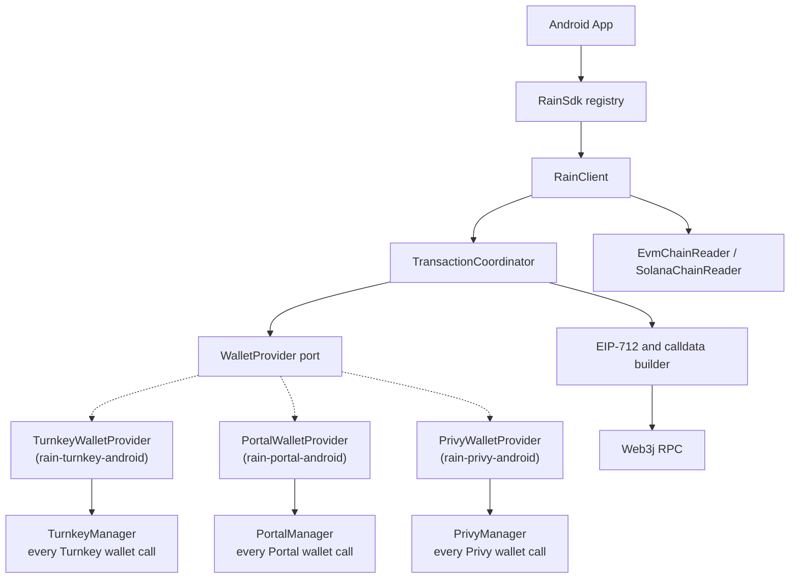

# rain-core-android

The vendor-free core of the modular Rain Android SDK: the "one core" in *one core, many providers*.

Contains:

- The **`WalletProvider`** port (the capability the SDK needs from any wallet);
  [Bring your own provider](#bring-your-own-provider) shows an implementation.
- The **`ProviderDescriptor`** + **`RainSdk`** builder/registry
  (`RainSdk.builder().register(...).build()`, resolve via `provider(id)` / `first { }`).
- The **`Capability`** model and **`ProviderId`**.
- All Rain domain logic: EIP-712 message building, collateral withdraw flow (EVM and Solana),
  transaction orchestration, chain readers, token metadata store.

Full parameter tables live in [docs/METHODS.md](../docs/METHODS.md).

`rain-core-android` has no wallet-vendor dependency at all; every vendor SDK lives in its own
adapter module. Add a wallet provider by depending on its adapter, which pulls core transitively:
[`rain-wallet-android`](../rain-wallet-android/README.md),
[`rain-turnkey-android`](../rain-turnkey-android/README.md),
[`rain-portal-android`](../rain-portal-android/README.md) or
[`rain-privy-android`](../rain-privy-android/README.md).

## Architecture



A provider is registered on the builder and resolved into a `RainClient` bound to that one wallet.

## Configuration

RPC endpoints are supplied on the builder, once, for every chain the app uses. `RainChain` holds the
chain-ID constants, including the Solana sentinels (`SOLANA_MAINNET` 900, `SOLANA_DEVNET` 901,
`SOLANA_TESTNET` 902) the SDK uses to route Solana work.

`registerTokens(...)` names tokens the SDK cannot discover on chain: an SPL mint carries no
on-chain symbol, and the built-in registry covers the mainnets plus the two Auth Pull sandbox
testnets (Base Sepolia, Arbitrum Sepolia). [Token metadata](../docs/METHODS.md#token-metadata) in
docs/METHODS.md has the checks; the same call exists on the builder and on a resolved `RainClient`.

## Bring your own provider

A wallet Rain ships no adapter for (Coinbase, Dynamic, a custom MPC stack, your own signing
backend) plugs in through core alone: implement the `WalletProvider` port, wrap it in a
`ProviderDescriptor`, and register that. Only `rain-core-android` is needed.

`WalletProvider` lives in `com.rain.sdk.provider`. Implementing it or `ProviderDescriptor` needs
`@OptIn(ExperimentalRainApi::class)` on your class, as below;
[Compatibility](../README.md#compatibility) says why. Nine members are required, the rest have
defaults, and an EVM-only wallet keeps the default `sendSolanaTransaction`, which refuses with
`RAIN_102`. `sponsorsFees(chainId)` follows `GAS_SPONSORSHIP` by default; override it when the
wallet sponsors on some chains only.

```kotlin
import com.rain.sdk.ExperimentalRainApi
import com.rain.sdk.RainSdk
import com.rain.sdk.error.RainError
import com.rain.sdk.models.Balance
import com.rain.sdk.models.RainTransaction
import com.rain.sdk.models.RainTransactionOrder
import com.rain.sdk.models.Token
import com.rain.sdk.provider.Capability
import com.rain.sdk.provider.ProviderContext
import com.rain.sdk.provider.ProviderDescriptor
import com.rain.sdk.provider.ProviderId
import com.rain.sdk.provider.WalletProvider
import java.math.BigDecimal
import kotlinx.coroutines.CancellationException

/** What you register. `create` runs on the first `rain.provider(id)`, and again after `reset()`. */
@OptIn(ExperimentalRainApi::class)
class MyWalletDescriptor(private val wallet: MyWalletSdk) : ProviderDescriptor {
    override val id = ProviderId("my-wallet")
    override val capabilities = emptySet<Capability>() // add EXPORT, MULTI_CHAIN, ... as you support them

    override suspend fun create(context: ProviderContext): WalletProvider =
        MyWalletProvider(wallet, context.rpcEndpoints)
}

/** The port. The wallet calls on the resolved `RainClient` end in one of these. */
@OptIn(ExperimentalRainApi::class)
class MyWalletProvider(
    private val wallet: MyWalletSdk, // your wallet SDK, whatever its shape
    private val rpcEndpoints: Map<Int, String>,
) : WalletProvider {
    override val id = ProviderId("my-wallet")

    // A chain your wallet cannot broadcast on fails closed here, before any read or signing prompt.
    override fun requireSendSupport(chainId: Int) {
        if (chainId !in rpcEndpoints) throw RainError.ChainNotSupported(chainId, "no RPC endpoint configured")
    }

    override suspend fun getWalletAddress(): String = guarded { wallet.address() }

    override suspend fun signTypedData(chainId: Int, walletAddress: String, typedDataJson: String): String =
        guarded { wallet.signTypedData(chainId, typedDataJson) }

    override suspend fun sendTransaction(chainId: Int, from: String, to: String, data: String, value: String): String =
        guarded { wallet.send(chainId, to, data, value) }

    override suspend fun estimateTransactionFee(chainId: Int, from: String, to: String, data: String, value: String): BigDecimal =
        guarded { wallet.estimateFee(chainId, to, data, value) }

    override suspend fun sendNativeToken(chainId: Int, toAddress: String, amountInEth: BigDecimal): String =
        guarded { wallet.sendNative(chainId, toAddress, amountInEth) }

    override suspend fun sendToken(chainId: Int, contractAddress: String, toAddress: String, amount: BigDecimal, decimals: Int): String =
        guarded { wallet.sendToken(chainId, contractAddress, toAddress, amount, decimals) }

    override suspend fun getBalance(chainId: Int, token: Token): Balance = guarded {
        val (raw, decimals) = wallet.balance(chainId, (token as? Token.Contract)?.address)
        Balance(token = token, chainId = chainId, rawAmount = raw, decimals = decimals)
    }

    override suspend fun getBalances(chainId: Int): List<Balance> = listOf(getBalance(chainId, Token.Native))

    override suspend fun getTransactions(chainId: Int, limit: Int?, offset: Int?, order: RainTransactionOrder?): List<RainTransaction> =
        emptyList() // or map your indexer's rows onto RainTransaction

    private inline fun <T> guarded(block: () -> T): T = try {
        block()
    } catch (e: CancellationException) {
        throw e
    } catch (e: RainError) {
        throw e
    } catch (e: MyWalletSdk.SessionExpired) {
        throw RainError.TokenExpired()
    } catch (e: Exception) {
        throw RainError.ProviderError(e)
    }
}

val rain = RainSdk.builder()
    .rpcEndpoints(mapOf(8453 to "https://mainnet.base.org"))
    .register(MyWalletDescriptor(myWalletSdk))
    .build()
val client = rain.provider(ProviderId("my-wallet"))
```

Convert your vendor's exceptions to `RainError` before they leave your adapter. Core passes a
`RainError` through with its code; the withdrawal paths alone rewrap a simulation failure as
`WithdrawalRevertedByNetwork`. Anything else it wraps as `ProviderError` after its shared prose
heuristics, with two exceptions. On `estimateGas`, `estimateWithdrawalFee` and the Solana
`withdrawCollateral` / `prepareWithdrawal` paths a raw exception floors at `InternalError`. The
hooks core calls before it enters a wrapper (the EVM wallet-address read and `requireSendSupport`
on `withdrawCollateral`) are not wrapped at all, so a raw exception there reaches the host as
thrown. A vendor exception that escapes therefore loses the specific code a host branches on, and
an expired session arrives as a generic error with no re-authentication hook.
